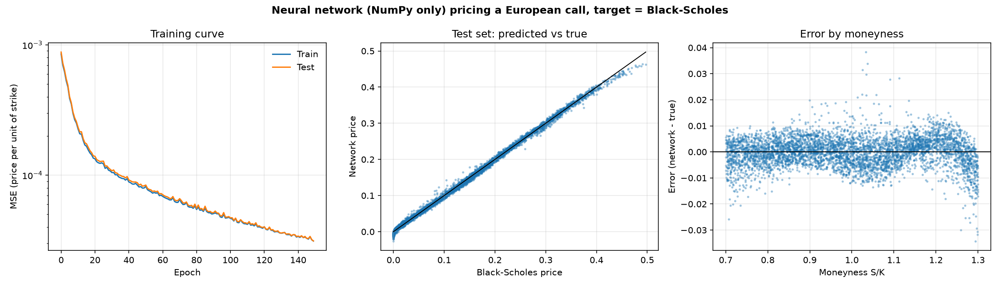
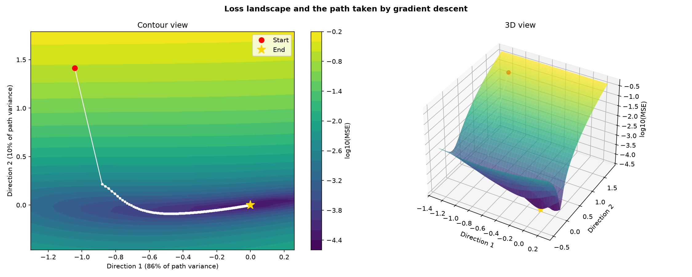

# Neural Network from Scratch: Pricing a European Call Option

A small neural network written in pure NumPy, with backpropagation coded by hand. It learns to price a European call option and is checked against the exact Black-Scholes formula. After training, the script draws the loss landscape around the solution and the path gradient descent took through it.

## Question

Can a small network learn the Black-Scholes pricing function from examples alone, and what does the optimisation look like along the way?

## Why Black-Scholes as the target

The true price is known exactly, so the network's error can be measured without ambiguity. This is a test of the learning code, not a trading model. No market data is used and nothing here predicts prices.

## Setup

- Inputs: moneyness S/K (0.7 to 1.3), maturity (0.1 to 2 years), volatility (10% to 50%), interest rate (0% to 5%)
- Target: call price per unit of strike, computed with Black-Scholes
- Data: 20,000 training and 5,000 test samples drawn at random (seeded for reproducibility)
- Network: 4 inputs, two hidden layers of 32 units with tanh, 1 linear output (1,249 parameters)
- Loss: mean squared error
- Optimiser: mini-batch gradient descent with momentum (batch 256, learning rate 0.05, momentum 0.9, 150 epochs)
- Backpropagation is written by hand and checked against finite differences before training

## Loss landscape

The weights are saved after every epoch. The two main directions of that path are found with an SVD (principal components), and the loss is evaluated on a grid in the plane they span. The training path is then drawn on top. The idea follows Li et al. (2018), "Visualizing the Loss Landscape of Neural Nets".

The surface is a 2D slice of a space with 1,249 dimensions, so it shows the path's neighbourhood and not the whole landscape.

## How to run

```bash
pip install -r requirements.txt
python nn_option_pricing.py
```

The run takes a few seconds. Output is written to `output/`:

- `results.png`: training curve, predicted vs true price on the test set, error by moneyness
- `loss_landscape.png`: contour and 3D view of the loss with the gradient descent path

The console also prints the gradient check result, the test RMSE and the maximum absolute error.

## Results





After 150 epochs the network reaches a test RMSE of 0.0056 and a maximum absolute error of 0.038, both per unit of strike (about 0.6% and 3.8% of the strike). Train and test MSE end almost equal (3.12e-05 and 3.13e-05), so there is no sign of overfitting. The loss was still falling at epoch 150, so training had not fully converged. The error plot shows the largest misses near the upper end of the moneyness range (around 1.3) and a few larger errors around at-the-money options. In the loss landscape, the path drops steeply at first and then follows a narrow, curved valley toward the minimum. The two plotted directions capture 96% of the path variance.

## Limitations

- The data is simulated from the Black-Scholes formula. The network learns that formula, not real market prices.
- Black-Scholes assumes constant volatility and no dividends, so it is a simplified model of option prices.
- Accuracy is not uniform across the input space. The error plot shows where it is larger.
- The architecture and hyperparameters were not tuned systematically.
- The loss landscape plot is a 2D slice of a 1,249-dimensional space.
